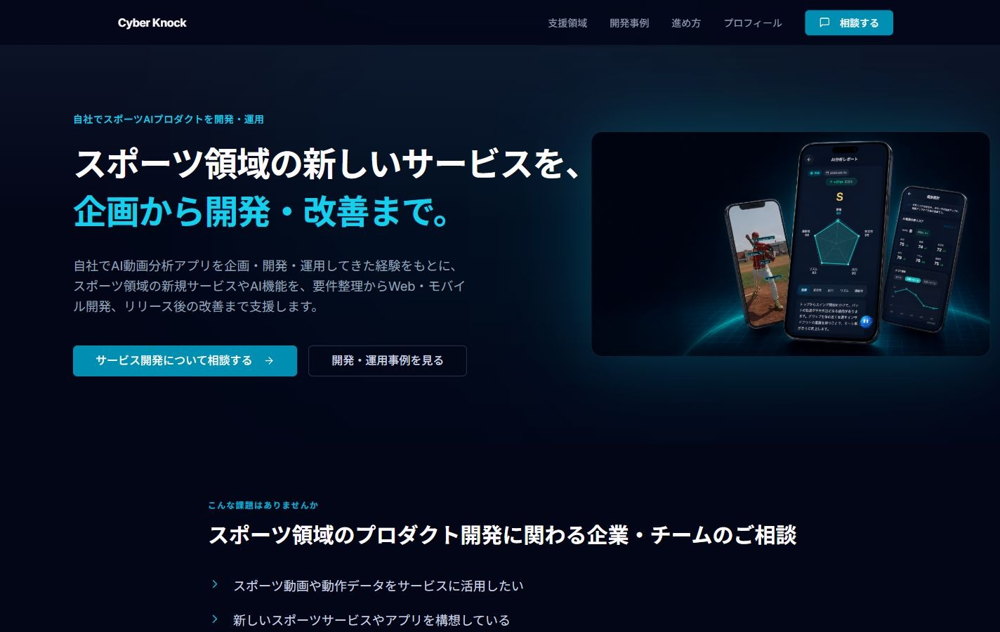
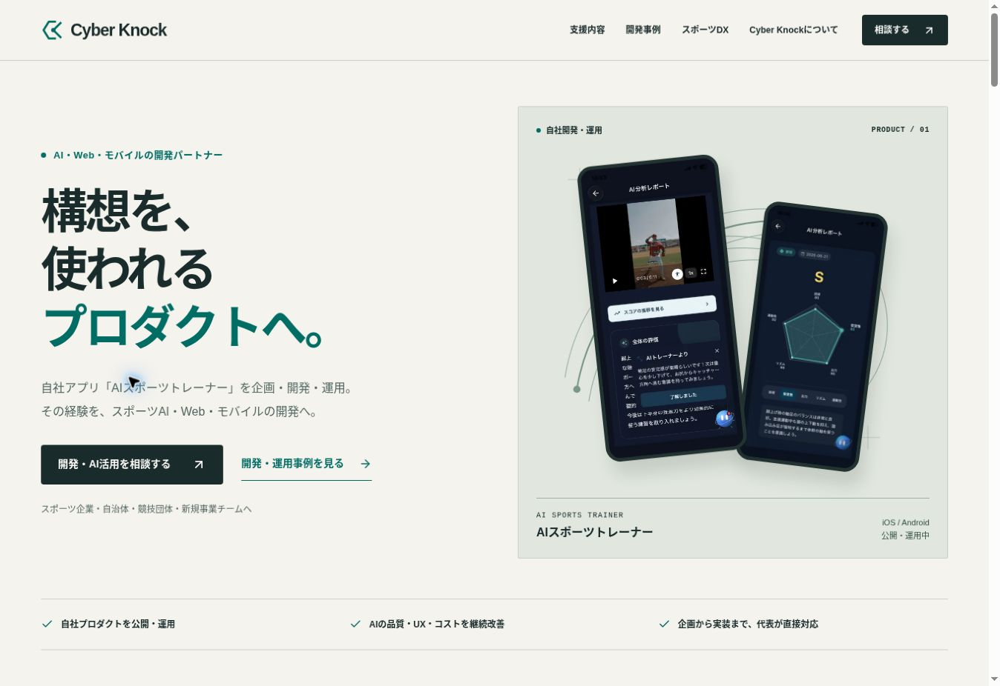
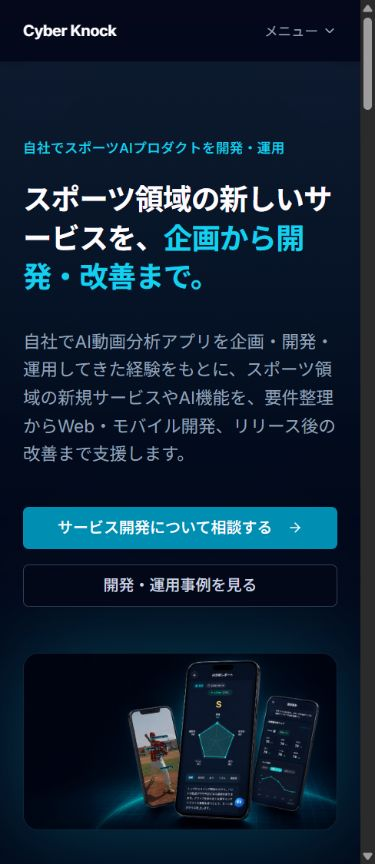
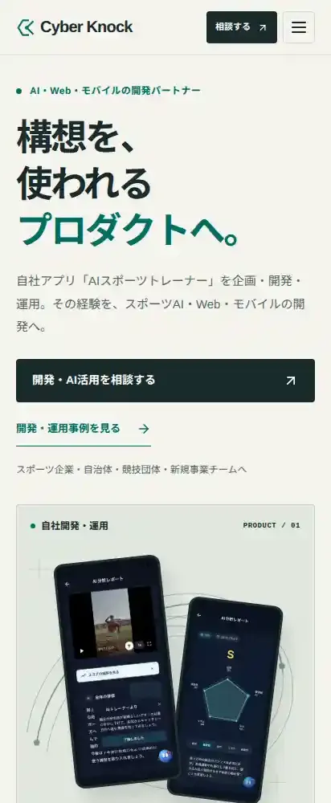

# Cyber Knock — 全面改善・実装・検証レポート

2026-11-02 / 対象: <https://cyberknock.pages.dev/> / Repository: `exorql/cyberknock`

## 先に結論

主要5ページ、共通デザイン、問い合わせ、計測コードを実装し、3サイクルの視覚レビューと修正を行った。既存のNext.js静的出力・Cloudflare Pages構成を維持し、[Draft PR #2](https://github.com/exorql/cyberknock/pull/2)と[改善プレビュー](https://feat-website-redesign-202611.cyberknock.pages.dev/)で確認できる。本番mainへのマージ・本番公開は行っていない。

正しい日本語フォントで測定したLighthouse Mobileは主要5ページでPerformance 99、Accessibility / Best Practices / SEO 100。ラボLCPは1.78〜2.17秒、CLSは0。問い合わせは外部通知を行わない専用プレビューで、入力検証、送信中、成功、失敗と入力保持を実操作で確認した。

一方、指定の100点表では78.75〜82.25点で、**主要ページ90点・独創性9/10という完成目標には届いていない**。受賞相当、WCAG 2.2 AA完全適合、実ユーザーCWV達成、CVR改善を宣言しない。実機・実通知・実ユーザーの理解度と商談品質は、別途確認が必要である。

## 1. 現状診断と、改善を必要とした理由

基準ソースはmain `5d86802c2a7655da221f0f624a4479d509cc4acc`。README、AGENTS相当の開発ルール、依存、静的出力、Cloudflare Function、既存の所在地訂正PRを確認した。既存の未コミット作業を上書きしないcheckoutで実装した。

対象は `/`、`/sports-dx`、`/cases/ai-sports-trainer`、`/security`、`/privacy-policy` とトップ内の問い合わせ。ソースから、robots・sitemap、問い合わせFunction、公開ストア・製品サイトへのリンクも確認した。公開URLは維持した。

| 変更前の問題 | 発注検討への影響 | 今回の対応 |
| --- | --- | --- |
| 自社アプリの開発・運用経験が、冒頭の提供価値と結びつきにくい | 「AIを作れる会社」の一般論に見え、判断材料を探す必要がある | 冒頭に実アプリ名、企画・開発・運用、スポーツAI・Web・モバイルを明記 |
| スポーツ向けの説明がサービス全体を覆う | 関連するアプリ開発・AI改善の相談範囲が狭く見える | 4サービスを顧客、課題、支援範囲、想定成果物、事例、相談で整理 |
| 加工イメージに比べて、実UIと運用の判断が弱い | 実際に提供・運用している証拠が伝わりにくい | 実画面、公開ストア、自社担当範囲、品質・課金・コストの説明を関連づける |
| フォームの前後で必須値・型等を十分に検証していない | 不正・不完全な問い合わせ、例外、分かりにくい失敗が起き得る | 両側の検証、上限、origin、honeypot、timeout、アクセシブルな状態を実装 |
| Privacyのtitle・lang・descriptionと共通デザインが欠落 | 閲覧者の信頼、操作性、検索上の基本品質を損なう | 同URLのApp Routerへ移行し、内容を保持して共通シェル・目次・metadataを適用 |
| 主要情報の初期表示がIntersectionObserverとフェードに依存 | すぐに理解したい人の情報取得を遅らせる | 内容を初期HTMLから可視化、動きは操作補助と概念図に限定 |
| コントラストとキーボード・状態通知の不足 | 読みにくさ、操作の迷い、入力時の障壁になる | 共通token、focus、skip link、menu状態、label・エラー通知を整備 |
| 解約済み所在地が公開表示に残る | 事業者情報が不正確 | 既存Draft PR #1で確認された東京都三鷹市へ整合 |

変更前の実スクリーンショットは5ページ×375 / 390 / 768 / 1024 / 1440px。Windows Chromeのスクロールバー分、本文領域は設定幅より15px小さい。全ページの全操作・全スクロール位置の合格を意味しない。[BASELINE.md](BASELINE.md)、[before/](before/)、[REVIEW-BEFORE.md](REVIEW-BEFORE.md) に根拠を保存した。

## 2. ベンチマークと、選んだコンセプト

### 受賞の公式確認と、参考にした原則

| サイト | 確認した賞 | Cyber Knockへ再構成した原則 |
| --- | --- | --- |
| [Dropbox Brand](https://brand.dropbox.com/) | Awwwards Site of the Month（2025年2月）、Developer Award | 少数の色・線・文字の役割を決め、図と画面全体へ同じ規則を適用 |
| [OddCommon](https://www.oddcommon.com/) | Webby Awards 2025 Best Practices Winner、Best Home Page Nominee | 実在する担当者と成果物を強く見せ、規模を装わず専門性で信頼を作る |
| [MacMillan Studio](https://macmillan.studio/) | FWA of the Day（2026-10-29） | 個人の専門性と案件で担う範囲を具体的に説明 |
| [Lando Norris](https://landonorris.com/) | Awwwards Site of the Year 2025、Developer Award | スポーツ固有の題材を、写真だけでなく情報と視覚の体系へつなぐ |

公式確認: [Awwwards](https://www.awwwards.com/websites/sites_of_the_month/)、[The Webby Awards](https://winners.webbyawards.com/2025/websites-and-mobile-sites/features-design/best-home-page/336323/oddcommon-website)、[FWA](https://thefwa.com/cases/macmillan-studio) / [FWA RSS](https://thefwa.com/rss/)。

BtoBは [Work & Co](https://work.co/)、[thoughtbot](https://thoughtbot.com/)、[ustwo](https://ustwo.com/)、[Goodpatch](https://goodpatch.com/ja) を比較。実績を中心に置くこと、相談の段階を広く受け止めること、担当範囲と進め方を具体化することを採用した。各社の非公開CVR・商談率を推定していない。全サイトのMobile・性能・全インタラクションは未測定。見られなかった描画箇所も未評価とした。

見た目や画像、独自書体、モーションのコピーは行っていない。12観点ごとの比較と出典は [BENCHMARKS.md](BENCHMARKS.md)。

### 3案の比較と採用理由

| 案 | 強み | 制約・判断 |
| --- | --- | --- |
| **動きから、事業へ。** | 実UI、映像フレーム、観測・反復の概念図でスポーツと運用経験を結べる。軽量なCSS/SVGで成立 | 主案として採用。図が実測データと誤認されない注記を付ける |
| 運用する開発室。 | 技術判断・工程・担当範囲を編集的に示し、BtoBの判断を助ける | 事例・データ文書へ部分採用。これだけでは固有性が弱い |
| 次の一歩を、ともに。 | 本人・現場の写真で距離感と信頼を作れる | 新しい本人・現場写真の権利と実態を確認できる素材が不足。主案にはしない |

紙色・墨色・teal、観測枠、反復する線、実画面という構成に統一。Heroは「構想を、使われるプロダクトへ。」とし、そのすぐ下で自社アプリの企画・開発・運用と提供領域を説明する。これは理解を助ける設計仮説であり、3〜5秒理解の実測達成ではない。

## 3. 完成した実装とP0

| 対象 | 実装内容 |
| --- | --- |
| トップ | Hero、実UI、2つのCTA、運用経験、判断図、4サービス、DX導線、進め方、代表者、FAQ、問い合わせ |
| スポーツDX | 対象者別の実証テーマ、3つの判断と成果物の概念図、進め方、成果物表、評価条件、品質・データ・費用、直接相談 |
| AIスポーツトレーナー事例 | 実UIギャラリーと拡大、背景、担当範囲、簡略構成、品質の判断、運用上の課題、検証可能な公開先 |
| データ取り扱い | 既存9項目を維持、目次、本文幅、共通ナビ、関連相談導線 |
| プライバシー | 既存12条を保持、同URL移行、metadata、共通スタイル、目次、所在地の整合 |
| 共通 | デザイントークン、header/footer、skip link、focus、menu状態とEscape、reduced motion、forced colors |
| フォーム | 前後validation、必須4項目、予算等の任意化、送信中・成功・失敗・保持、honeypot、body上限、origin、timeout |
| 計測 | 9イベントの許可リスト。PII・任意URLを送らず、既存gtagがある時だけ動作 |
| 品質運用 | 型検査、18テスト、静的build、固定版Lighthouse、JPフォント確認、CI閾値、保存可能な監査結果 |

P0は、価値理解、相談範囲、実績、相談導線、デザイン統一、初期表示、既知の重なり・見出し分断、コントラスト、フォーム検証と例外処理、基本SEO、事業者情報の不整合について実装した。検証の範囲と残る条件は [IMPLEMENTATION.md](IMPLEMENTATION.md) のID別表を参照。確認できない導入数・精度・成長率・顧客・従業員・売上・受賞歴は追加していない。

元のReact / Next / Tailwind / Cloudflare Pages Functionを維持し、本番依存ライブラリは追加していない。実アプリ画像をWebP化して320 / 480 / 640wを用意し、表示幅に応じて配信。画像の人物・結果・文字内容は生成・改変していない。unused UIディレクトリまで走査していたTailwindの範囲を公開コンポーネントへ絞り、CSSを軽量化した。

### 反復した修正

1. **第1サイクル:** 実装をDesktop/Mobileで確認。端末画像と実績名の重なり、細いh1、小さい補助文字、DXの不自然な見出し改行を検出。
2. **第2サイクル:** 画像とcaptionを別領域にし、見出しのウェイトと列幅、Mobile文字、ギャラリーサイズ、同意欄を修正。Desktopと実フォームfocusを再確認。
3. **第3サイクル:** 運用の判断図と実証の概念図を整備。画像のsrcsetとCSSを改善。CIで日本語フォント欠落を発見して測定条件を修正し、正しい描画で全5ページを再測定。

各レビューはクリエイティブ、UX、技術QA、BtoB発注者の4視点。AIによる自己・チームレビューであり、独立した顧客調査ではない。初期の不良や無効な測定は削除せず、原因と再測定を記録した。

## 4. Desktop / Mobile比較

### Desktop

変更前: Windows Chrome、設定1440pxの保存画像上部。変更後: Cloud Chrome、viewport1363×936、本文幅1348。異なるviewportなので、画素単位の速度・密度比較には使わない。

### Mobile

変更前: 設定390pxの実ブラウザ。変更後: Lighthouseの412px全ページ画像から上部を切り出したもの。指定幅の最終比較は別の幅別QA記録を優先する。

特に改善したのは、提供領域と運用経験の明示、実アプリの存在、相談と事例の優先順位、ページ間の統一、フォームの状態とエラーである。before/afterの全体構成、5ページの画像は各cycleディレクトリと [BROWSER-CHECKS.md](BROWSER-CHECKS.md) を参照。

## 5. 品質検証

### 指定100点表による評価

達成度0〜10から各配点へ換算。変更前7項目は当時のレビュー値を保持し、未評価だった技術だけを有効な保存監査から補足した。変更前・後の観察者と範囲に差があり、盲検ユーザー評価ではない。

| ページ | Before /100 | After /100 | 90点目標 |
| --- | ---: | ---: | --- |
| トップ | 69.75 | 82.25 | 未達 |
| スポーツDX | 71.00 | 79.25 | 未達 |
| 開発事例 | 72.75 | 81.00 | 未達 |
| データ取り扱い | 71.50 | 78.75 | 未達 |
| プライバシー | 56.75 | 79.00 | 未達 |

8項目×5ページの達成度、換算点、観測根拠、残る問題は [QUALITY-SCORES.md](QUALITY-SCORES.md)。主な未達は独創性、さらに具体的な実運用の意思決定事例、文書ページから相談へのつながり。実装できるレイアウト・導線・状態は改善したが、確認できない成果や架空の素材で点数を上げない。法務文書へ不要な演出を加えて独創性だけを追わない。

### Lighthouse Mobile

有効な比較は [cycle4](lighthouse-cycle4/DIAGNOSIS.md)。Lighthouse12.8.2、Node22.23.4、Chrome156.0.8078.47、Ubuntu26.04、Noto Sans CJK JP。412×823、DPR1.75、simulated mobile、CPU4倍、RTT150ms、1638.4Kbps。1回／ページ。run [41416034210](https://github.com/exorql/cyberknock/actions/runs/41416034210)。

| ページ | Before P / A / BP / SEO | After P / A / BP / SEO | LCP Before→After | After TBT | CLS Before / After |
| --- | --- | --- | --- | ---: | --- |
| トップ | 93 / 93 / 100 / 100 | 99 / 100 / 100 / 100 | 3.124→2.121秒 | 42ms | 0 / 0 |
| スポーツDX | 95 / 96 / 100 / 100 | 99 / 100 / 100 / 100 | 2.921→1.814秒 | 68ms | 0 / 0 |
| 開発事例 | 95 / 96 / 100 / 100 | 99 / 100 / 100 / 100 | 2.905→2.173秒 | 44.5ms | 0 / 0 |
| データ取り扱い | 95 / 95 / 100 / 100 | 99 / 100 / 100 / 100 | 2.907→1.786秒 | 76ms | 0 / 0 |
| プライバシー | 100 / 90 / 96 / 82 | 99 / 100 / 100 / 100 | 1.013→1.784秒 | 78ms | 0 / 0 |

BeforeはCloudflare本番HTTPS、Afterはgzip付きローカルproduction exportであり、配信・キャッシュ条件が同じ実験ではない。因果的な速度向上率を出さない。Privacyは共通シェルを追加してLCPが長くなったため「全ページ高速化」とは書かない。TBTはINPではない。fieldのLCP / INP / CLSと75パーセンタイルは未取得。

### アクセシビリティ・動作

| 項目 | 確認結果と限界 |
| --- | --- |
| 自動アクセシビリティ | 主要5ページ100。以前の色、リンク識別、Privacyのlang等の検出事項を修正。自動監査だけでAA適合とはしない |
| コントラスト | 指定色25組を計算。対象の通常文字は最低4.660:1、入力枠3.170:1、通常focus5.607:1。実アプリ画像内・透過最終ピクセル等は別 |
| キーボード | skip link、Tab、メニューEnter/Escape/focus復帰、同意Space、入力エラーと成功focusを実操作 |
| フォーム | 合成データ・通知モックで必須、メール形式、任意、送信中、失敗・保持、成功、成功後の回遊を確認 |
| 計測 | 画面上のモックで6種のイベントを確認。PII・query・hashを含まない。許可リストは自動テスト。実GA4受信は未確認 |
| リンク・画像 | 主要ナビ、DX/事例→テーマ選択、データ目次、実UI読み込み、公式ストア・製品サイトを確認 |
| レスポンシブ | Before5幅、After Desktopと412pxを確認。指定6幅の最終QAは別記録。実機や全ブラウザの合格とはしない |
| モーション | 初期内容を隠さず、prefers-reduced-motionで動き・smooth scrollを無効化。WebGLは採用しない |
| 自動テスト | contact12件＋analytics6件、計18件。型検査・静的buildをCIと隔離checkoutで確認 |

根拠: [STATIC-QA.md](STATIC-QA.md)、[BROWSER-CHECKS.md](BROWSER-CHECKS.md)、[問い合わせQA](contact-qa/RESULTS.md)、[保存LHR](lighthouse-cycle4/reports.zip)。実際のサイト通知は送っていない。

### 未達・未検証

- デザイン評価90点以上、造形・独創性90%以上は未達。現状の点数を合格へ丸めない。
- iOS Safari／Android Chrome実機、Firefox、VoiceOver／TalkBack／NVDA、200%文字拡大・400%ズーム・text spacingの完全確認は未実施。
- 実ユーザーCWV、問い合わせCVR、商談化率、案件化・受注率、対象者5名の理解度は未測定。
- 本番通知設定・到達、GA4プロパティ接続、edgeのrate limiting等の運用設定は未確認。秘密情報を取得していない。
- データ文書は既存の運用記載を維持した。実際の全データフローや契約上の法的妥当性まで再監査したものではない。
- 公開先はプレビュー。mainへのマージ・本番公開は明示的な承認が必要。

## 6. 事業成果の検証計画

最も改善を期待する導線は「提供領域と自社運用経験を理解 → 実アプリと開発判断を確認 → 文脈を保って相談」。もうひとつは「DX実証の目的・成果物を理解 → sports-dxを選択済みの相談」である。改善を期待するという仮説と、改善済みという実績を分ける。

### 仮説と測る指標

| 仮説 | 補助KPI | 最終的に確認すること |
| --- | --- | --- |
| 提供範囲と実績をHeroで明示すると相談の関連性を判断しやすい | Hero CTA率、事例遷移率 | 有効問い合わせ／訪問者、相談内容の適合度 |
| 実UIと運用上の判断が発注不安を減らす | 事例表示→相談、フォーム開始 | 商談化率、営業で繰り返し聞かれる不安の変化 |
| 予算未定・仕様未確定を受け止めると初期相談を取りこぼしにくい | 開始→完了、エラー率 | 未定リードも含めた商談・案件化の質 |
| DXの成果物と評価条件が組織内説明を助ける | sports-dx CTA、テーマ付き相談 | 自治体・団体の有効相談、実証設計へ進んだ件数 |

実装した9イベントは `cta_click`、`case_study_click`、`case_study_view`、`store_click`、`contact_form_start`、`contact_form_submit`、`contact_form_error`、`contact_form_success`、`contact_form_abandon`。単なるクリック・成功イベントを「有効問い合わせ」や「受注」と呼ばない。

有効問い合わせは、営業運用で「スパム・重複を除外し、提供範囲に関係する具体的な事業相談」と定義して担当者が判定する。問い合わせ、商談、案件、受注を内部の管理番号で関連づけ、PIIやCRM原文を分析イベントへ送らない。低トラフィックの短期変動から改善を断定せず、流入構成と対象期間、分母、除外条件を揃えて比較する。分析APIは既存キャッシュ・保存集計を優先し、同じ取得を繰り返さない。

公開後は、まず所有するGA4等の接続・プライバシー方針・重複発火を確認し、DebugViewで許可属性だけを受信することを検証する。データが十分に集まってから週次・月次で有効問い合わせ、訪問→相談CVR、相談→商談、商談→案件化・受注を見る。小標本なら点推定だけで結論を出さず、実数・期間・不確かさを併記する。

理解度テストは実際の対象者5名を募集し、初見10秒で「誰向けか／何を依頼できるか／他社との違い」を説明してもらう。目標は4名以上が主要な対象と依頼範囲を説明できること。AIの回答を人数に含めない。台本、指標定義、イベントの限界は [MEASUREMENT-PLAN.md](MEASUREMENT-PLAN.md)。

## 公開判断と引き継ぎ

コード・測定・画像・未達事項をDraft PRでレビューできる状態にする。本番公開の承認を得る前に、実際の通知設定、PreviewとProductionの環境差、既存所在地PR #1との重複を確認する。フロントとFunctionの同時公開が必要で、旧フォームだけが新しい必須同意検証へ送る組み合わせを作らない。

この成果は実装と検証を伴う改善版であり、依頼文の全完成条件の達成宣言ではない。確認できる証拠を維持して、実機・対象者・実運用で次の判断を行う。
