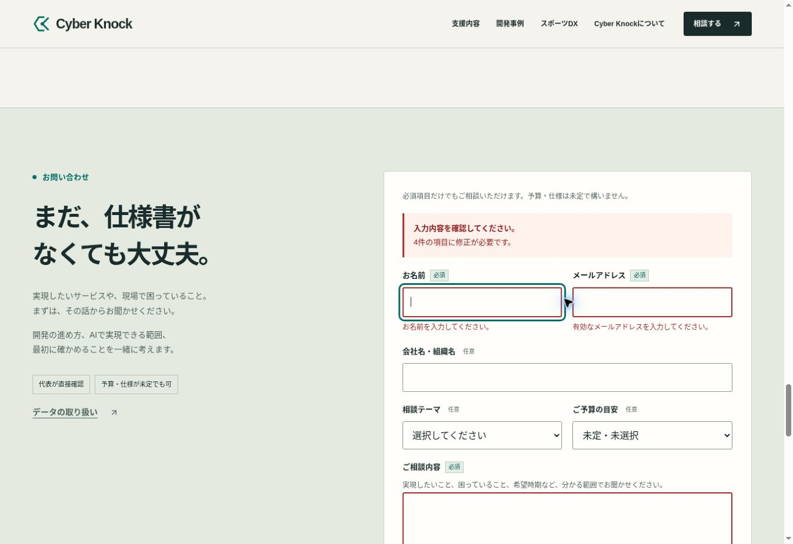
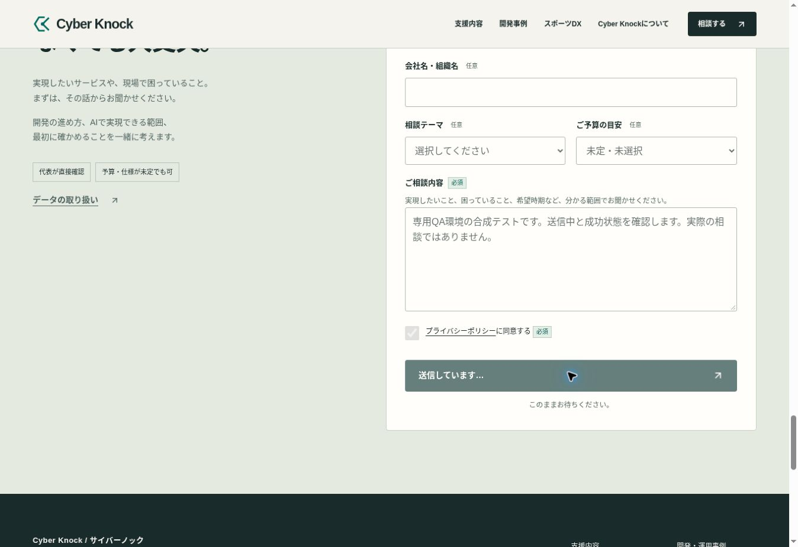
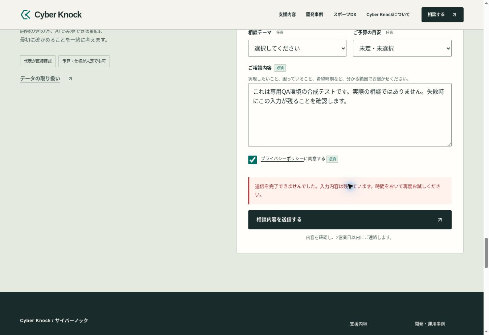
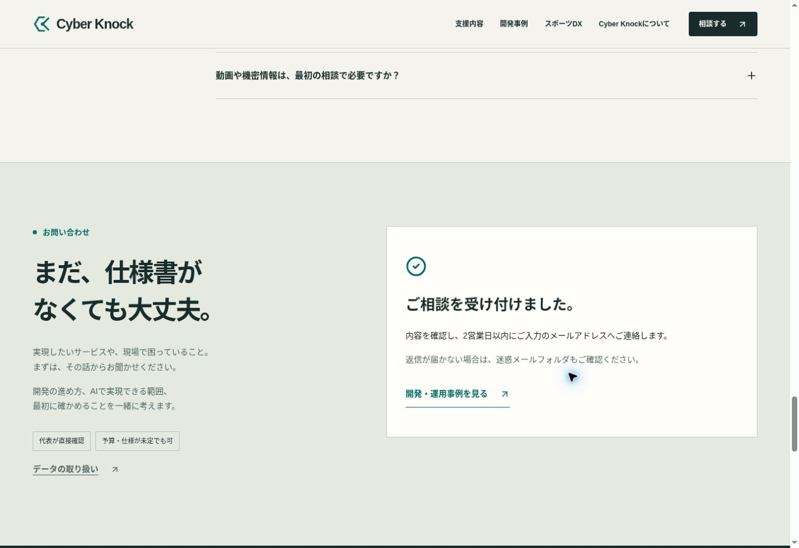

# 問い合わせ・計測の実ブラウザ検証

検証日: 2026-11-02 09:16–09:19 UTC。専用QA preview: <https://944221fb.cyberknock.pages.dev/>。

## 検証環境と、本番の通知との区別

対象UIは改善版commit `f1b4d4e59a6665d0f593b541e16c9bc49e2ea00b` と同じ。専用branch `qa/contact-validation-20261102` / commit `3d37fbcc91ee859445078b4a9401a9930acb25aa` で、問い合わせFunctionの入口だけを外部通信のないResponderへ変更した。**本番改善PRへこのQA差分を含めない。**

- `handleContact` と入力検証helperは本番改善版の取得文字列と一致。
- QA入口は実環境のWebhook設定を読まず、実際の `fetch` を呼ばない。ダミー環境と応答関数を注入する。
- 同一originのRefererに `qa=failure / success / slow` がある場合だけ動作を切り替える。未指定・不正値は失敗。
- ページ冒頭へ「動作確認用・お問い合わせは届きません」を表示。noindex・no-storeを設定。
- `window.gtag` はメモリ内の引数表示のみ。分析サービスへ送信しない。
- Chromeの実ブラウザ、viewport 1363×936 CSS px。フォームのMobile実操作・実通知到達・GA4受信を示す検証ではない。
- 合成氏名、`example.invalid` の合成メール、テストである旨を明記した本文のみ使用。

## 実操作の結果

| ケース | 実際の操作・観測 | 結果 |
| --- | --- | --- |
| 未入力送信 | 必須4項目にエラー。件数と個別メッセージを表示。`aria-invalid` と `aria-describedby` を確認。描画後の `activeElement` はname input | PASS |
| メール形式 | 他の必須項目を入力して `invalid-email` を送信。メールのみエラー、描画後にemailへフォーカス | PASS |
| 任意項目 | 会社、相談テーマ、予算を未選択のまま、必須項目だけで送信 | 成功モックへ到達。予算未定を拒否しない |
| 同意のキーボード操作 | 本文からTabで同意へ移動しSpaceでチェック | PASS |
| 同意のクリック操作 | 同意checkboxをクリックしchecked=trueを確認 | PASS |
| 送信中 | slowモードで送信。`aria-busy=true`、送信ボタンdisabled、「送信しています…」「このままお待ちください。」、入力欄disabledを確認 | PASS |
| 送信失敗 | failureモードの疑似上流500を、共通handlerが502へ変換。エラーと再試行案内を表示 | PASS |
| 失敗後の入力 | 名前、本文、同意状態が保持。メール欄も入力済み状態。送信ボタンと欄が再度操作可能 | PASS。メール値は観測出力でredactされたため完全一致の実画面証拠は保存しない |
| 送信成功 | slowモードの疑似200。成功案内と返信目安・迷惑メール案内を表示。フォームを置き換え、成功h3へフォーカス | PASS |
| 成功後の回遊 | 成功案内の事例リンクをクリック | 開発・運用事例へ遷移 |
| 事例→相談 | 事例Heroの相談CTAをクリック | home `?service=sports-ai#contact` へ遷移し、相談テーマが「スポーツAI・動画分析」になる |

ブラウザの自動scrollを伴う `setChecked` は2回、チェック状態を変えられなかった。現在位置を再確認後の通常クリックとキーボード操作では成功した。操作ツールの一時的な不成功を隠さず記録するが、この結果だけからサイトのチェックボックス不良とは判定しない。

## 計測の確認

画面上のQAイベントログから以下を確認した。

- 未入力: `contact_form_start` → `contact_form_error(error_type=validation)`。
- 不正メール: `contact_form_error(error_type=validation)`。
- 失敗: `contact_form_submit` → `contact_form_error(error_type=server)`。
- 成功: `contact_form_start` → `contact_form_submit` → `contact_form_success`。
- 成功後の事例: `case_study_click(location=contact)` → `case_study_view(page=case_study)`。
- 事例から相談: `cta_click(location=case, service=sports-ai)`。

保存した [events.json](events.json) は成功〜事例〜相談の6イベント。氏名、合成メール、本文は含まれない。`page_location` は本番の固定パスで、QA hostname・query・hashは含まれず、`page_referrer` は空文字。失敗・入力エラーの引数は実ブラウザで読んだが、そのDOM JSONの別ファイルは保存していない。

`store_click` と `contact_form_abandon` の実ブラウザ発火、実GA4の受信は本記録の検証範囲外。9イベントの許可リストとPII除外は別の自動テストで確認する。詳細な集計上の制限は [MEASUREMENT-PLAN.md](../MEASUREMENT-PLAN.md)。

## スクリーンショット

## 未確認のもの

本番Webhookへの到達、Slack側の受信、実GA4の受信、iOS Safari／Android Chromeでの送信、スクリーンリーダーによる音声出力は未確認。自動テストでは上流エラー・入力不正等を扱っているが、本番への実メッセージ送信は行っていない。

ブラウザのログには拡張機能由来のmetadata送信エラーが継続して存在した。サイトの実装エラーと区別し、「ブラウザ全体のエラー0」とは記載しない。
